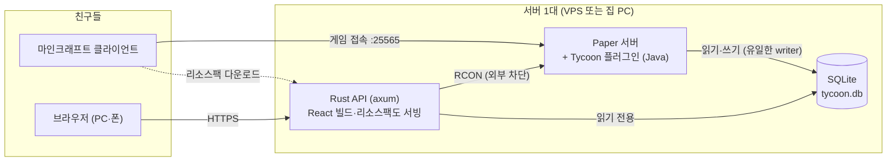
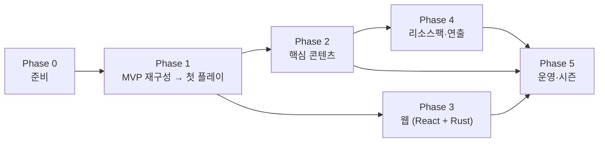

# 친구들과 하는 타이쿤 서버 — 개발 계획서

> 작성일 2026-10-31 · 분석 대상: 업로드한 `ThingTycoon-1.21.4-source.zip`
>
> **전제**
>
> - `rea`는 **React**로 이해했어요.
> - 마인크래프트 **Java Edition** 서버를 열어 친구들(10명 이하)과 같이 플레이하는 게 목표예요.
>   마인크래프트 없이 브라우저 게임으로 따로 만들 생각이었다면 이 계획 전체가 달라져요.
> - 띵타이쿤의 이름·리소스팩·고유 콘텐츠를 그대로 옮기는 1:1 복제가 아니라,
>   **같은 장르(채집 → 판매 → 강화)의 우리 서버**를 만드는 계획이에요.

## 요약

| 질문                         | 결론                                                                                                                            |
| ---------------------------- | ------------------------------------------------------------------------------------------------------------------------------- |
| 이 zip이 띵타이쿤 서버 소스? | **아니에요.** README에 "원본 띵타이쿤의 공식 플러그인 또는 소스코드가 아닙니다"라고 적힌 독립 제작 MVP. Java 파일 1개(208줄). |
| 그대로 쓸 수 있나?           | 시작점으로는 좋지만 **무한 돈 버그**가 있어서, 누가 발견하는 순간 경제가 무너져요.                                              |
| React·Rust로 만들 수 있나?   | 게임 본체(Paper 플러그인)는 **Java(또는 Kotlin)만 가능**. React는 웹사이트, Rust는 웹 API 서버에 써요.                          |
| Rust 쓸 데가 있나?           | **웹 API 서버 한 곳에는 가치가 있어요.** 게임 서버 자체를 Rust로 만드는 건 비추천.                                              |
| 언제 친구들과 놀 수 있나?    | Phase 1이 끝나는 **약 3~4주 뒤 첫 플레이**. 그다음부터는 플레이하면서 기능을 더해요.                                            |

---

## 1. 업로드한 소스 분석

### 1.1 정체

- 구성: `ThingTycoon.java` 1개(208줄), `plugin.yml`, `config.yml`, `pom.xml`, `README.md`
- 대상: Paper 1.21.4, Java 21, Maven
- README 원문
  - "원본 띵타이쿤의 공식 플러그인 또는 소스코드가 아닙니다."
  - "JAR 컴파일 검증은 수행하지 못했습니다." → 작성자도 빌드해 보지 않은 초안이에요.
    이번 분석도 코드를 읽어서 했고 빌드는 못 했어요. **Phase 0의 첫 작업이 빌드 확인**이에요.
- 클래스 하나가 이벤트 리스너·명령어·GUI·저장을 전부 맡고 있어서, 기능을 더하려면 먼저 나눠야 해요.

### 1.2 들어 있는 기능

| 기능        | 방식                                                | 메모                                                 |
| ----------- | --------------------------------------------------- | ---------------------------------------------------- |
| 돈          | 플레이어별 YAML 파일의 `money`, 시작 1000원         | `/tt balance`, `/tt pay`, `/tt top`                  |
| 직업 5종    | miner, farmer, lumberjack, fisher, hunter           | 현재 직업 활동만 XP. 레벨업 보너스 = 레벨 × 100원    |
| 활동 감지   | 블록 파괴(광질·벌목·농사), 낚시, 몹 처치            | 블록 이름 패턴으로 판별 (`_ORE`, `_LOG` …)           |
| 상점 GUI    | `config.yml` 가격표. 구매 = 가격 × 2, 판매 = 가격 × 1 | 좌클릭 1개 구매, 우클릭 같은 재료 전량 판매          |
| 도감        | 활동한 블록 종류별 카운트                           | 채팅 텍스트 출력만                                   |
| 반복 퀘스트 | 어떤 활동이든 25회마다 1500원                       | 리셋 없음                                            |
| 보물 티켓   | 활동마다 2.5% 확률, 열면 500~3000원                 |                                                      |
| 밀수        | 에메랄드 5개 → 4000원, 30분 쿨타임                  |                                                      |

README에 적힌 미구현 목록: 낚시 미니게임·물고기 등급, 던전·보스, NPC, 땅·보호 구역, 은행, 경매장,
리소스팩, 도감 GUI, 일일 퀘스트 리셋, 직업 스킬, 관리자 GUI.

### 1.3 문제점 (심각한 순)

줄 번호는 `ThingTycoon.java` 기준이에요.

| #   | 심각도  | 문제                                                                                                                                                         | 위치              | 고치는 방법 (Phase 1)                                         |
| --- | ------- | ------------------------------------------------------------------------------------------------------------------------------------------------------------ | ----------------- | ------------------------------------------------------------- |
| 1   | 🔴 치명 | **무한 돈.** 직접 설치한 블록을 부숴도 보상. 조약돌·돌도 광질로 인정되고, 작물은 심자마자 부숴도 인정                                                        | L80-88            | 설치한 블록 표시, 작물 성장 단계 확인, 조약돌·돌 보상 제외    |
| 2   | 🟠 높음 | 돈·활동이 바뀔 때마다 YAML 파일을 **메인 스레드에서 동기 저장**. 블록 하나 캘 때마다 디스크 쓰기 → 여럿이 채굴하면 렉                                        | L41, L44, L75     | 메모리 캐시 + 비동기 일괄 저장                                |
| 3   | 🟡 보통 | 보상 리스너가 기본 우선순위(NORMAL). 보호 플러그인이 더 늦은 우선순위에서 파괴를 취소하면 블록은 그대로인데 보상만 받을 수 있음                               | L84, L89, L96     | `priority = MONITOR` + `ignoreCancelled = true`               |
| 4   | 🟡 보통 | 모든 몹 처치가 보상 → 스포너·번식 농장으로 자동 사냥 가능                                                                                                    | L96-99            | Paper의 `Entity#fromMobSpawner()`, `getEntitySpawnReason()`   |
| 5   | 🟡 보통 | 도감이 부정확. 낚시는 무엇을 낚든 COD, 사냥은 무엇을 잡든 ROTTEN_FLESH로 기록                                                                                | L91, L98          | 실제로 낚은 아이템, 잡은 몹 종류로 기록                       |
| 6   | 🟡 보통 | 가격이 `Material` 단위. 이름 바꾼 아이템도 같은 값이고, 나중에 만들 커스텀 아이템(예: 전설 물고기)을 바닐라 대구와 구분 못 함                                 | L122, L135, L160  | 아이템 PDC에 아이템 ID를 저장하는 체계                        |
| 7   | ⚪ 낮음 | 상점을 창 제목 문자열로 판별 → 모루로 같은 이름을 붙인 상자도 상점처럼 동작                                                                                  | L118              | 전용 `InventoryHolder`로 판별                                 |
| 8   | ⚪ 낮음 | `ChatColor`, `getTitle()`, `setDisplayName(String)` 등 deprecated API. 최신 Paper로 올리면 경고가 많고 일부는 없어질 수 있음                                  | L42, L102-107, L118 | Adventure / MiniMessage로 교체                                |
| 9   | ⚪ 낮음 | 메시지 접두사와 상점 제목에 "띵타이쿤"을 그대로 씀                                                                                                           | L42, L107         | 우리 서버 이름으로 교체                                       |

**1번이 얼마나 심각한지:** 조약돌 1개를 설치하고 부술 때마다

- 퀘스트: 1500원 ÷ 25회 = **60원**
- 보물 티켓 기대값: 2.5% × 평균 1750원 ≈ **44원**
- 합계 **약 104원**. 곡괭이로 부수면 조약돌이 다시 나오니까 블록 1개로 무한 반복돼요.
  상점에서 조약돌을 4원에 사서 해도 이득이에요.

### 1.4 밸런스 관찰

- **퀘스트 보상이 판매 수익을 압도해요.** 조약돌 25개를 팔면 50원인데, 같은 25번 활동의 퀘스트 보상은
  1500원(30배)이에요. 보물 기대값까지 합치면 일반 활동 수입 대부분이 "무엇을 캤나"가 아니라
  "몇 번 캤나"에서 나와요. 타이쿤의 핵심인 "비싼 걸 캐서 판다"가 의미 없어져요.
  → 보상을 **횟수가 아니라 가치** 기준으로 바꿔요.
- 레벨업이 너무 빨라요. Lv1 → 2에 140 XP = 블록 14개.
- 직업 변경이 무료·즉시예요(L155). 직업마다 다르게 크는 재미가 약해져요.
- 돈을 쓰는 곳(money sink)이 상점 구매밖에 없어요. 돈이 쌓이기만 하면 인플레이션이 와요.
  → 강화·땅·수수료 같은 소모처가 필요해요.

---

## 2. 기술 스택

### 2.1 꼭 알아야 할 제약

마인크래프트 Java 서버(Paper)는 **JVM 위에서** 돌아가고, 서버 안의 게임 로직(플러그인)은
**Java 또는 Kotlin**으로만 만들 수 있어요.

- React는 브라우저 UI 라이브러리라서 마인크래프트 안에서는 못 써요 → **웹사이트**에 써요.
- Rust도 Paper 플러그인을 만들 수 없어요 → **서버 바깥 프로그램**에 써요(2.3).

그래서 "React + Rust로 만든다"는 **게임 본체는 Java, 주변(웹·도구)은 React + Rust**가 돼요.

### 2.2 최종 스택

| 영역      | 기술                                  | 이유                                                                   |
| --------- | ------------------------------------- | ---------------------------------------------------------------------- |
| 게임 서버 | **Paper**                             | 플러그인 생태계, 바닐라 기능 완비                                      |
| 게임 로직 | **Java + Gradle** (`run-paper`)       | `./gradlew runServer` 한 줄로 플러그인을 넣은 테스트 서버 실행         |
| 데이터    | **SQLite** (WAL 모드)                 | 파일 하나, 설치 불필요. 웹 API가 동시에 읽을 수 있음. 커지면 PostgreSQL |
| 웹 화면   | **React + Vite + TypeScript**         | 랭킹·도감·시세·관리자 페이지                                           |
| 웹 API    | **Rust (axum + sqlx)**                | 2.3 참고                                                               |
| 리소스팩  | 바닐라 리소스팩 (`item_model`)        | 모드 없이 커스텀 아이템 모양                                           |
| 모델링    | Blockbench                            | 무료, 마인크래프트 모델 제작 표준 도구                                 |

**버전 고르기.** 2026년 3월 26.1부터 마인크래프트 버전 표기가 26.x로 바뀌었고, 26.1 이상은
**Java 25**가 필요해요(1.21.x는 Java 21). MVP는 1.21.4 기준이에요.

- 추천: Paper 다운로드 페이지에서 experimental 표시가 없는 최신 버전 중, 쓸 플러그인(WorldGuard,
  LuckPerms 등)이 지원하는 버전을 골라 **시즌 동안 고정**.
- 친구들 런처도 같은 버전으로 맞추기. 안 맞으면 ViaVersion으로 접속은 되지만, 리소스팩 커스텀
  아이템은 클라이언트 버전이 다르면 깨질 수 있어서 버전을 통일하는 게 나아요.

### 2.3 Rust 분석 — 어디에 쓸 가치가 있나

| 후보                                     | 판정        | 이유                                                                                                                                                                                                                                                                                                                                                                                                 |
| ---------------------------------------- | ----------- | ---------------------------------------------------------------------------------------------------------------------------------------------------------------------------------------------------------------------------------------------------------------------------------------------------------------------------------------------------------------------------------------------------- |
| A. 게임 서버 자체를 Rust로 (Pumpkin 등)  | ❌          | Pumpkin은 공식적으로 "heavy development" 단계. 몹·동물·보스·주민이 W.I.P이고 Paper 플러그인(WorldGuard, LuckPerms, NPC…)이 기본으로는 돌지 않아요. 낚시·사냥·GUI 상점처럼 타이쿤에 필요한 걸 바닥부터 만들어야 해요.                                                                                                                                                                                              |
| B. 플러그인 안에서 JNI로 Rust 호출       | ❌          | 게임 로직은 계산량이 작아서 빨라질 게 없고, OS별 네이티브 빌드만 늘어요.                                                                                                                                                                                                                                                                                                                             |
| C. **웹 API 서버**                       | ✅ **추천** | ① 게임 서버와 다른 프로세스라 웹이 죽어도 게임은 멀쩡 ② 메모리를 적게 써서 JVM 옆에 두기 좋음 ③ 바이너리 1개로 API + React 빌드 + 리소스팩 파일까지 서빙 ④ `sqlx`가 SQL을 실제 DB 스키마와 **컴파일할 때** 대조 → 플러그인 쪽에서 스키마를 바꾸면 API 빌드가 바로 깨져서 알 수 있음 ⑤ `ts-rs`로 Rust 응답 타입에서 TypeScript 타입을 자동 생성 → React와 타입이 어긋나지 않음 |
| D. 경제 밸런스 시뮬레이터 (Rust → WASM)  | 🔶 선택     | 관리자 페이지에서 가격·확률을 바꾸면 "1시간 플레이 수입 분포"를 바로 계산. 유용하지만 TypeScript로도 충분해서 여유 있을 때.                                                                                                                                                                                                                                                                           |
| E. 리소스팩 빌드 CLI                     | 🔶 선택     | JSON 검증 → zip → SHA-1 계산 → `server.properties` 갱신. 셸 스크립트로도 충분.                                                                                                                                                                                                                                                                                                                       |
| F. 테스트용 봇 (Azalea)                  | ⚪          | 같은 용도라면 JavaScript의 Mineflayer가 자료가 더 많아요.                                                                                                                                                                                                                                                                                                                                            |
| G. 디스코드 봇                           | ⚪          | DiscordSRV 플러그인으로 대부분 해결돼요.                                                                                                                                                                                                                                                                                                                                                             |

**결론:** Rust는 **C(웹 API) 하나**로 시작하고 D는 선택이에요. Rust가 부담되면 C를
TypeScript(Hono 등)로 바꿔도 React 쪽은 그대로예요. API 응답 형식만 같으면 돼요.

### 2.4 직접 만들지 말고 가져다 쓸 것

| 필요                              | 플러그인                                                       |
| --------------------------------- | -------------------------------------------------------------- |
| 권한 그룹 (관리자 / 플레이어)     | LuckPerms                                                      |
| 맵 제작, 구역 보호 (스폰·광산)    | WorldEdit, WorldGuard                                          |
| 상점 NPC                          | Citizens 또는 FancyNpcs                                        |
| 렉 원인 분석                      | spark                                                          |
| 디스코드 채팅 연동 (선택)         | DiscordSRV                                                     |
| 다른 클라이언트 버전 허용 (선택)  | ViaVersion                                                     |
| 폰·콘솔 친구 (선택)               | Geyser (커스텀 GUI·리소스팩은 Bedrock에서 다르게 보일 수 있음) |

**직접 만드는 건** 타이쿤의 정체성인 경제·직업·아이템·낚시·퀘스트·도감·시세뿐이에요.

---

## 3. 전체 구조



**규칙 4가지**

1. **게임 데이터의 주인은 플러그인 하나.** DB에 쓰는 건 플러그인뿐이에요.
2. **웹은 읽기 전용.** 관리자가 웹에서 가격을 바꾸면 API가 RCON으로 플러그인 명령
   (`/tt admin price set …`)을 보내고, 검증과 저장은 플러그인이 해요. 미리 정한 명령만 통과시켜요.
3. **DB 스키마 = 플러그인 담당과 웹 담당 사이의 계약.** `docs/schema.sql`로 관리하고, 바꿀 때마다
   `schema_version`을 올려요.
4. **RCON 포트(25575)는 방화벽으로 외부 차단.** RCON은 암호화가 없어요.

### 3.1 DB 스키마 v1

```sql
-- docs/schema.sql — 플러그인(쓰기)과 Rust API(읽기)의 계약
-- 연결할 때 PRAGMA journal_mode = WAL; 로 열어야 API가 동시에 읽을 수 있음

CREATE TABLE players (
  uuid       TEXT PRIMARY KEY,
  name       TEXT NOT NULL,
  money      INTEGER NOT NULL DEFAULT 0,  -- 정수(원). 실수 금지
  job        TEXT,
  first_join INTEGER NOT NULL,            -- unix ms
  last_seen  INTEGER NOT NULL
);
CREATE INDEX players_name ON players (name COLLATE NOCASE);

CREATE TABLE job_progress (
  uuid  TEXT NOT NULL REFERENCES players (uuid),
  job   TEXT NOT NULL,
  level INTEGER NOT NULL DEFAULT 1,
  xp    INTEGER NOT NULL DEFAULT 0,
  PRIMARY KEY (uuid, job)
);

CREATE TABLE collection (                 -- 도감
  uuid     TEXT NOT NULL REFERENCES players (uuid),
  item_id  TEXT NOT NULL,                 -- 'minecraft:cod', 'ourtycoon:golden_tuna'
  count    INTEGER NOT NULL DEFAULT 0,
  best     INTEGER,                       -- 최고 기록 (물고기 크기 등)
  first_at INTEGER NOT NULL,
  PRIMARY KEY (uuid, item_id)
);

CREATE TABLE economy_log (                -- 모든 돈 변화: 악용 추적 + 웹 그래프 + 밸런스 분석
  id      INTEGER PRIMARY KEY,
  uuid    TEXT NOT NULL,
  delta   INTEGER NOT NULL,
  balance INTEGER NOT NULL,               -- 변경 후 잔액
  reason  TEXT NOT NULL,                  -- 'sell', 'quest', 'pay_out', 'upgrade' …
  detail  TEXT,                           -- 'ourtycoon:golden_tuna x3'
  at      INTEGER NOT NULL
);
CREATE INDEX economy_log_uuid_at ON economy_log (uuid, at);

CREATE TABLE market (                     -- 현재 시세
  item_id       TEXT PRIMARY KEY,
  base_price    INTEGER NOT NULL,
  current_price INTEGER NOT NULL,
  updated_at    INTEGER NOT NULL
);

CREATE TABLE market_history (             -- 10분마다 기록 → 웹 차트
  item_id TEXT NOT NULL,
  price   INTEGER NOT NULL,
  at      INTEGER NOT NULL
);

CREATE TABLE quest_progress (
  uuid     TEXT NOT NULL,
  quest_id TEXT NOT NULL,
  period   TEXT NOT NULL,                 -- '2026-11-01'(일일), '2026-W45'(주간)
  progress INTEGER NOT NULL DEFAULT 0,
  claimed  INTEGER NOT NULL DEFAULT 0,
  PRIMARY KEY (uuid, quest_id, period)
);

CREATE TABLE server_status (              -- 플러그인이 15초마다 갱신, 웹 홈 화면용
  id         INTEGER PRIMARY KEY CHECK (id = 1),
  online     TEXT NOT NULL,               -- JSON 배열 ["닉네임1", "닉네임2"]
  tps        REAL NOT NULL,
  updated_at INTEGER NOT NULL
);

CREATE TABLE schema_version (version INTEGER NOT NULL);
```

설치한 블록 표시(1.3의 1번)는 DB가 아니라 청크 데이터(PDC)에 저장해요.

### 3.2 저장소 구조

이 `test` 저장소와 섞지 말고 **새 저장소**를 만드는 걸 추천해요.

```
our-tycoon/
├─ plugin/                  Paper 플러그인 (Java, Gradle)
│  └─ src/main/java/…/
│     ├─ TycoonPlugin.java  진입점 — 등록만
│     ├─ storage/           DB 연결, 스키마 버전, 비동기 저장
│     ├─ economy/           지갑, 거래 로그
│     ├─ item/              아이템 ID(PDC), 커스텀 아이템 레지스트리
│     ├─ job/               직업, XP, 스킬
│     ├─ gather/            채굴·벌목·농사·낚시·사냥 → 보상 (악용 방지 포함)
│     ├─ market/            상점, 시세
│     ├─ quest/             일일·주간 퀘스트
│     ├─ collection/        도감
│     ├─ gui/               메뉴 프레임워크
│     └─ command/           /tt 명령어
├─ api/                     Rust (axum)
├─ web/                     React + Vite + TypeScript
├─ content/                 아이템·물고기·퀘스트 정의 (YAML) — 기획 담당이 수정
├─ resourcepack/            리소스팩 원본
├─ server/                  로컬 테스트 서버 설정 (서버 jar·월드는 .gitignore)
└─ docs/                    schema.sql, 밸런스 표, 회의 메모
```

---

## 4. 로드맵



| Phase | 내용                   | 기간 (대략)              | 끝나면                       |
| ----- | ---------------------- | ------------------------ | ---------------------------- |
| 0     | 준비                   | 1주                      | 모두 로컬에서 MVP 실행       |
| 1     | MVP 재구성·버그 수정   | 2~3주                    | **첫 플레이**                |
| 2     | 핵심 콘텐츠            | 4~8주 (반복)             | 타이쿤다운 성장 루프         |
| 3     | 웹 (React + Rust)      | 3~4주, Phase 1 이후 병렬 | 랭킹·도감·시세 사이트        |
| 4     | 리소스팩·연출          | 2~4주, Phase 2와 병렬    | 커스텀 아이템 모양           |
| 5     | 운영·시즌              | 계속                     | 백업, 밸런스 조정, 시즌      |

> 기간은 2~4명이 저녁·주말에 작업한다고 가정한 대략치예요.

### Phase 0 — 준비 (1주)

목표: 모두가 같은 환경에서 MVP를 띄워 볼 수 있다.

- [ ] 서버 이름·컨셉 정하기 → 메시지 접두사, 상점 이름, 아이템 네임스페이스에 써요
      (예: `ourtycoon:golden_tuna`)
- [ ] 마인크래프트 버전 정하고 고정하기 (2.2 참고)
- [ ] 설치: JDK(고른 버전에 맞게 21 또는 25), IntelliJ IDEA Community, Git
      / 웹 담당은 Node.js LTS / API 담당은 rustup
- [ ] 새 GitHub 저장소 + 3.2 구조. `.gitignore`에 서버 jar·월드·`*.db` 추가
- [ ] MVP 코드를 `plugin/`으로 옮기고 Maven → Gradle(`run-paper`)로 전환
- [ ] **빌드 확인.** 원작자도 못 했다고 적어 놨어요. 에러가 나면 여기서 고쳐요
- [ ] 로컬 서버에 접속해서 `/tt` 명령을 전부 눌러 보기
- [ ] 1.3의 무한 돈 버그를 직접 재현해 보기 → 나중에 테스트 케이스가 돼요
- [ ] 호스팅 방식 정하기

| 방식                     | 장점                       | 단점                                                            |
| ------------------------ | -------------------------- | --------------------------------------------------------------- |
| 친구 PC에서 열기         | 무료, 쉬움                 | 그 PC가 켜져 있어야 함. 포트포워딩이나 터널(playit.gg 등) 필요 |
| VPS                      | 24시간, 웹·API도 같은 곳에 | 월 사용료, 리눅스 기본 지식                                     |
| 마인크래프트 전용 호스팅 | 관리 패널이라 쉬움         | Rust API·웹을 같이 돌리기 어려운 곳이 많음                      |

메모리는 친구 10명 이하면 Paper에 4~6GB 정도면 돼요.

**완료 기준:** 누구든 `./gradlew runServer` → `localhost` 접속 → `/tt shop`이 열린다.

### Phase 1 — MVP 재구성 + 버그 수정 → 첫 플레이 (2~3주)

목표: 기능은 지금과 같지만 **악용이 안 되고, 렉이 없고, 웹이 읽을 수 있는** 구조.

1. **코드 나누기** — 3.2의 패키지 구조로. 진입점 클래스는 등록만 해요.
2. **저장소 교체: YAML → SQLite**
   - 접속 직전 `AsyncPlayerPreLoginEvent`에서 비동기 로드 → 메모리 캐시 → 변경은 메모리에만 →
     30초마다 + 퇴장·종료 시 비동기 저장
   - 플레이어·월드 같은 Bukkit API는 메인 스레드에서만 만지고, DB 읽기·쓰기만 비동기로
   - 돈은 정수(원). 실수(double) 금지
   - 모든 돈 변경은 `Economy.deposit / withdraw(uuid, amount, reason)` 한 곳으로 모아서
     `economy_log`에 기록 (악용 추적, 웹 그래프, 밸런스 분석에 다 써요)
   - 송금은 트랜잭션 하나로
   - sqlite-jdbc, HikariCP는 `plugin.yml`의 `libraries:`로 불러오면 jar에 넣지 않아도 돼요
3. **악용 방지** (1.3의 1·3·4번)
   - 설치한 블록 표시: `BlockPlaceEvent`에서 표시 → 그 블록을 부수면 보상 없음.
     **CustomBlockData** 라이브러리를 쓰면 편해요. 청크 PDC에 저장하고,
     `CustomBlockData.registerListener(plugin)`을 호출하면 블록이 부서질 때 지우고 피스톤으로
     밀리면 따라가요. (GPL-3.0)
   - 작물은 설치 표시 대신 **다 자랐는지**로 판정해요. 씨앗을 심는 것도 "설치"라서요.
   - 조약돌·돌은 보상에서 빼거나 아주 낮게 (용암 + 물 생성기 때문)
   - 몹: `fromMobSpawner()`면 보상 없음, 번식(`BREEDING`)으로 태어난 몹은 축소
   - 보상 리스너는 `EventPriority.MONITOR` + `ignoreCancelled = true`
4. **GUI 프레임워크** — 전용 `InventoryHolder`로 메뉴를 판별하고, 클릭·드래그를 기본으로 전부 취소한 뒤
   버튼마다 동작을 등록해요. 상점·도감·강화 메뉴가 전부 이걸 써요.
5. **아이템 ID 체계** — 아이템 PDC에 `ourtycoon:id`를 저장해요. 바닐라는 `minecraft:cod`,
   커스텀은 `ourtycoon:golden_tuna`. 상점·도감·시세 모두 이 ID 기준.
6. **메시지** — Adventure + MiniMessage로, `messages.yml`로 분리. "띵타이쿤"을 우리 서버 이름으로.
7. **밸런스 1차** — 퀘스트·보물 보상을 횟수 기준 → 가치 기준으로. 직업 변경에 쿨타임이나 비용.
8. **테스트** — MockBukkit으로 경제·직업 단위 테스트. 특히 "설치한 블록", "덜 자란 작물",
   "스포너 몹" 케이스.
9. **서버 상태 기록** — 15초마다 접속자·TPS를 `server_status`에 (웹 홈 화면용).

악용 방지 스케치 (개념 코드, 빌드 확인 안 함):

```java
// 작물은 '심기'도 설치라서 설치 표시 대신 성장 단계로 판정
private static final Set<Material> CROPS = Set.of(
        Material.WHEAT, Material.CARROTS, Material.POTATOES,
        Material.BEETROOTS, Material.NETHER_WART);

@EventHandler(priority = EventPriority.MONITOR, ignoreCancelled = true)
public void onPlace(BlockPlaceEvent e) {
    if (!CROPS.contains(e.getBlockPlaced().getType())) {
        placed.mark(e.getBlockPlaced());              // CustomBlockData 등으로 구현
    }
}

@EventHandler(priority = EventPriority.MONITOR, ignoreCancelled = true)
public void onBreak(BlockBreakEvent e) {
    Block b = e.getBlock();
    if (e.getPlayer().getGameMode() != GameMode.SURVIVAL) return;
    if (placed.isMarked(b)) return;                   // 직접 설치한 블록 → 보상 없음
    if (CROPS.contains(b.getType())
            && b.getBlockData() instanceof Ageable age // org.bukkit.block.data.Ageable
            && age.getAge() < age.getMaximumAge()) return;  // 덜 자란 작물
    rewards.onGather(e.getPlayer(), b);
}
```

**완료 기준**

- 조약돌을 100번 설치하고 부숴도 돈·XP·퀘스트 변화 0
- 4명이 동시에 채굴해도 TPS 20 근처 유지 (spark로 확인)
- `tycoon.db`를 DB Browser for SQLite로 열면 데이터가 보임
- **→ 여기서 친구들과 첫 플레이.** 이후 기능은 플레이하면서 더해요.

### Phase 2 — 핵심 콘텐츠 (4~8주, 반복)

타이쿤의 핵심 루프는 **채집 → 판매 → 돈 → 장비·스킬 강화 → 더 비싼 채집**이에요.
이 루프가 재밌는지가 전부예요. 아이템·물고기·지역의 이름과 수치는 우리가 직접 기획해요.

우선순위 순서:

1. **콘텐츠 데이터화** — `content/items.yml`, `fish.yml`, `quests.yml`. 코딩을 안 하는 친구도
   아이템·물고기를 추가할 수 있게 해요. 웹 도감 페이지도 같은 파일을 읽어요.

   ```yaml
   # content/fish.yml (예시 — 이름·수치는 우리가 정함)
   golden_tuna:
     name: "<gold>황금 참치"
     rarity: legendary # common / rare / epic / legendary
     base-price: 800
     size-cm: [60, 180]
     where: [ocean]
     time: [night]
     model: ourtycoon:golden_tuna
   ```

2. **장비 강화** — 곡괭이·도끼·괭이·낚싯대·검 +1~+10. 단계마다 채집 속도·추가 드롭·희귀 확률이 올라가요.
   비용은 돈 + 재료 → **가장 큰 돈 소모처**가 돼요.
3. **낚시 미니게임 + 물고기 등급** — 입질이 오면 보스바·액션바 게이지가 뜨고 우클릭 타이밍을 맞춰요.
   결과로 등급(일반~전설)과 크기(cm)가 정해지고, 가격 = 기본가 × 등급 배수 × 크기 보정.
   지역·시간·날씨·미끼에 따라 나오는 물고기가 달라요.
4. **직업 스킬** — 레벨 구간마다 패시브 (예: 광부 Lv10 — 5% 확률로 광석 2배).
5. **일일·주간 퀘스트** — 한국 시간 자정 리셋, 퀘스트 풀에서 랜덤 3개, 보상은 가치 기준.
6. **도감 GUI** — 카테고리별 페이지, 못 찾은 건 `???`, 카테고리를 다 채우면 칭호·작은 영구 버프.
7. **동적 시세** — 많이 팔리면 내려가고, 시간이 지나면 기본가로 회복. 10분마다 `market_history`에 기록.
   - 예시: `현재가 = 기본가 × max(0.5, 1 − 0.002 × 최근 1시간 판매량)`
8. **맵** — 스폰 마을(상점 NPC), 광산(WorldEdit 스키매틱으로 매일 리셋), 지역별 낚시터, 농장 구역,
   개인 땅(WorldGuard 구역).
9. **스코어보드·칭호·랭킹 보상**
10. (선택) 경매장, 은행 — 이자처럼 돈이 새로 생기는 곳은 인플레이션 주의.

**완료 기준:** 친구들과 2~3시간 플레이 테스트 → `economy_log`로 직업별 시간당 수입을 비교 →
차이가 크면 조정.

### Phase 3 — 웹 (React + Rust) (3~4주, Phase 1 이후 병렬 가능)

DB 스키마(3.1)가 정해지면 플러그인과 따로 시작할 수 있어요.

**Rust API (`api/`)**

- 크레이트: `tokio`, `axum`, `sqlx`(SQLite, 읽기 전용 연결), `serde`, `tower-http`(정적 파일·압축·CORS),
  `tracing`, `ts-rs`
- RCON 클라이언트: 기존 크레이트를 쓰거나 직접 구현해요. 패킷 구조가 단순해서 Rust 연습으로 좋아요.
- 엔드포인트 v1

| 메서드 | 경로                                       | 내용                                              |
| ------ | ------------------------------------------ | ------------------------------------------------- |
| GET    | `/api/status`                              | 접속자, TPS (`server_status`)                     |
| GET    | `/api/rankings?type=money`                 | 돈·직업 레벨 랭킹                                 |
| GET    | `/api/players/{name}`                      | 프로필: 돈, 직업, 도감 진행률                     |
| GET    | `/api/items`                               | 아이템·물고기 정의 + 아이콘 경로                  |
| GET    | `/api/market`, `/api/market/{id}/history`  | 시세, 차트 데이터                                 |
| POST   | `/api/admin/command`                       | 관리자 전용. 미리 허용한 명령만 RCON으로 전달     |

- 인증: v1은 관리자 비밀번호(환경 변수) + 세션 쿠키, 공개 페이지는 로그인 없음.
  v2에서 게임 안 `/tt web` → 1회용 로그인 링크.
- 배포: `cargo build --release` → 바이너리 1개 + `web/dist` → systemd 서비스.
  HTTPS는 Caddy(인증서 자동 발급) 앞에 두기.

**React (`web/`)**

- Vite + React + TypeScript, React Router, TanStack Query(데이터 요청·캐시), 차트 라이브러리(Recharts 등)
- 페이지: 홈(서버 상태·접속 방법), 랭킹, 플레이어 프로필, 도감, 시세 차트, 물고기 확률표,
  관리자(가격·퀘스트 수정, 총 통화량·시간당 수입 그래프)
- 아이콘: 리소스팩 텍스처 PNG를 그대로 써서 게임과 웹이 같은 그림
- 타입: `ts-rs`가 만든 타입 파일을 import
- 갱신은 10~30초 폴링으로 충분 (WebSocket은 나중에)

**완료 기준:** 친구가 폰으로 랭킹·도감·시세를 보고, 관리자가 웹에서 가격을 바꾸면 게임에 바로 반영된다.

### Phase 4 — 리소스팩 & 연출 (2~4주, Phase 2와 병렬)

- **커스텀 아이템 모양** — 1.21.4부터 아이템에 `item_model` 컴포넌트를 달고 리소스팩의
  `assets/<네임스페이스>/items/<id>.json`에 모델을 정의하면, 모드 없이 아무 바닐라 아이템이나
  우리 모델로 보여요. Paper API는 `ItemMeta#setItemModel(NamespacedKey)`.
- **제작** — Blockbench로 모델·텍스처
- **배포** — `server.properties`의 `resource-pack`(URL), `resource-pack-sha1`, `require-resource-pack`.
  zip은 Rust API가 HTTPS로 호스팅
- `pack.mcmeta`의 `pack_format`은 고른 버전에 맞추기
- **연출** — 희귀 물고기를 낚으면 효과음·파티클·전체 공지, 보물 상자 GUI 룰렛
- (선택·고급) 커스텀 폰트 문자로 GUI 배경 이미지
- (선택) Rust 리소스팩 빌드 CLI (2.3-E)
- **직접 만든 것이나 라이선스를 확인한 리소스만** 쓰기. 다른 서버 리소스팩을 추출해서 쓰지 않기

**완료 기준:** 접속하면 리소스팩이 자동으로 적용되고, 커스텀 물고기·도구가 고유한 모양으로 보인다.

### Phase 5 — 운영 & 시즌 (계속)

- **백업** — 매일 월드 + `tycoon.db`. 실행 중인 SQLite는 파일 복사 대신
  `sqlite3 tycoon.db ".backup 백업파일.db"`. 7일치 보관 + 외부 저장소. **복구 연습을 한 번은 꼭** 해요.
- **보안** — 화이트리스트, LuckPerms 그룹. RCON·관리자 비밀번호는 저장소에 올리지 않기.
- **업데이트** — 테스트 서버에서 먼저 → 백업 → 재시작으로 반영 (`/reload` 금지).
- **모니터링** — spark로 렉 원인 확인.
- **경제 감시** — 관리자 페이지의 총 통화량·시간당 수입 그래프. 인플레이션이면 시세·강화비 조정.
- **시즌제 (선택)** — 2~3개월마다 경제 리셋 + 시즌 랭킹 보상. 친구 서버를 오래 재밌게 하는 방법이에요.
- (선택) Rust 밸런스 시뮬레이터 (2.3-D)
- (선택) DiscordSRV — 채팅 연동, 희귀 물고기 알림

---

## 5. 역할 분담 예시

| 역할         | 하는 일                                                | 기술                  |
| ------------ | ------------------------------------------------------ | --------------------- |
| 플러그인     | 게임 로직 전부                                         | Java                  |
| 웹           | React 페이지                                           | TypeScript, React     |
| API·인프라   | Rust API, 서버 운영, 백업                              | Rust, Linux           |
| 기획·밸런스  | `content/*.yml`, 가격표, 퀘스트, 플레이 테스트 정리    | YAML, 스프레드시트    |
| 맵·리소스팩  | 건축, 모델·텍스처                                      | WorldEdit, Blockbench |

1~2명이면 Phase 순서대로 하고 웹(Phase 3)은 뒤로 미뤄도 돼요. 게임이 먼저예요.

## 6. 첫 주 체크리스트

1. 버전·서버 이름 정하기
2. 새 저장소 + 폴더 구조
3. MVP 빌드 → 로컬 서버 → `/tt` 명령 확인
4. 무한 돈 버그 재현
5. 역할 나누고 주 1회 플레이 테스트 날짜 잡기

## 7. 위험 요소

| 위험                          | 대응                                                                       |
| ----------------------------- | -------------------------------------------------------------------------- |
| 범위가 너무 커서 지침         | Phase 1이 끝나면 일단 플레이. 기능은 "이게 재밌나?"로 고르기               |
| 경제 붕괴 (인플레이션·악용)   | `economy_log`, 돈 소모처, 관리자 그래프, 시즌 리셋                         |
| 버전 업데이트로 플러그인 깨짐 | 시즌 중 버전 고정                                                          |
| 데이터 손실                   | 매일 백업 + 복구 연습                                                      |
| 언어가 많음 (Java·TS·Rust)    | Rust는 API 하나로 한정. 부담되면 TypeScript로 교체                         |
| 저작권·브랜드                 | 서버 이름·리소스팩·콘텐츠는 직접 제작                                      |
| EULA                          | 친구끼리 무료면 문제없음. 돈을 받고 게임 내 이득을 파는 건 EULA 위반 소지 |

## 8. 참고 자료

- Paper 시작 가이드 (버전별 Java 표): https://docs.papermc.io/paper/getting-started/
- 26.1 이상 Java 25 필요 (CubeCoders 포럼):
  https://discourse.cubecoders.com/t/startup-issue-with-minecraft-minecraft-26-1-and-newer-requires-java-25/39955
- 26.1 업데이트 가이드 (OXY.Games): https://oxy.games/en/blog/minecraft-server-update-26-1
- Pumpkin (Rust 마인크래프트 서버): https://github.com/Pumpkin-MC/Pumpkin
- Rust 서버 비교 (호스팅 업체 자료라 참고만): https://supercraft.host/wiki/minecraft/pumpkin_ferrumc_minestom/
- CustomBlockData: https://github.com/mfnalex/CustomBlockData
- Paper API 소스 (`Entity#fromMobSpawner`, `ItemMeta#setItemModel`): https://github.com/PaperMC/Paper
